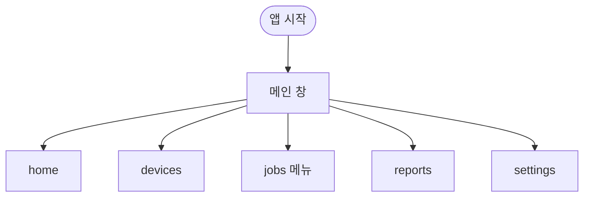
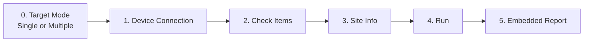
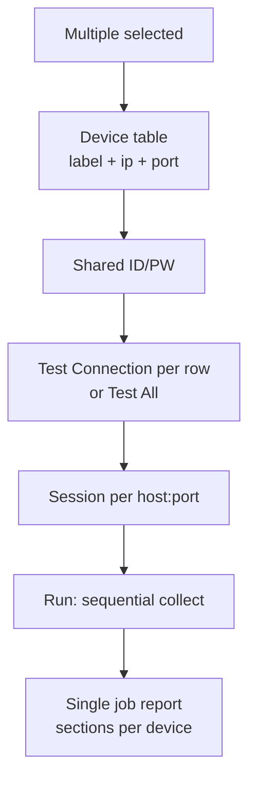
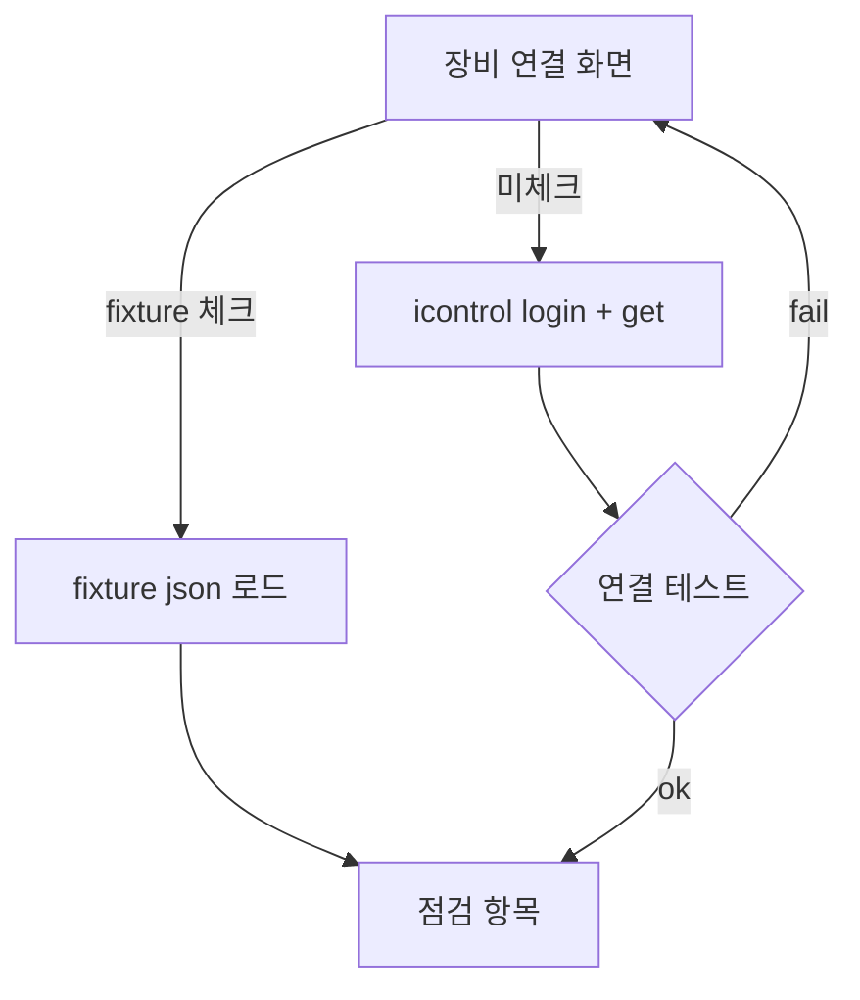
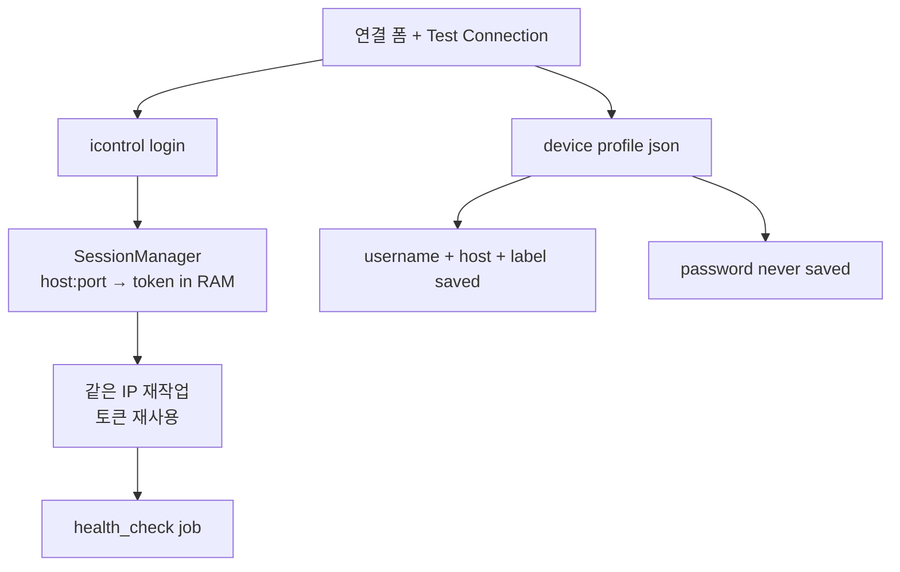
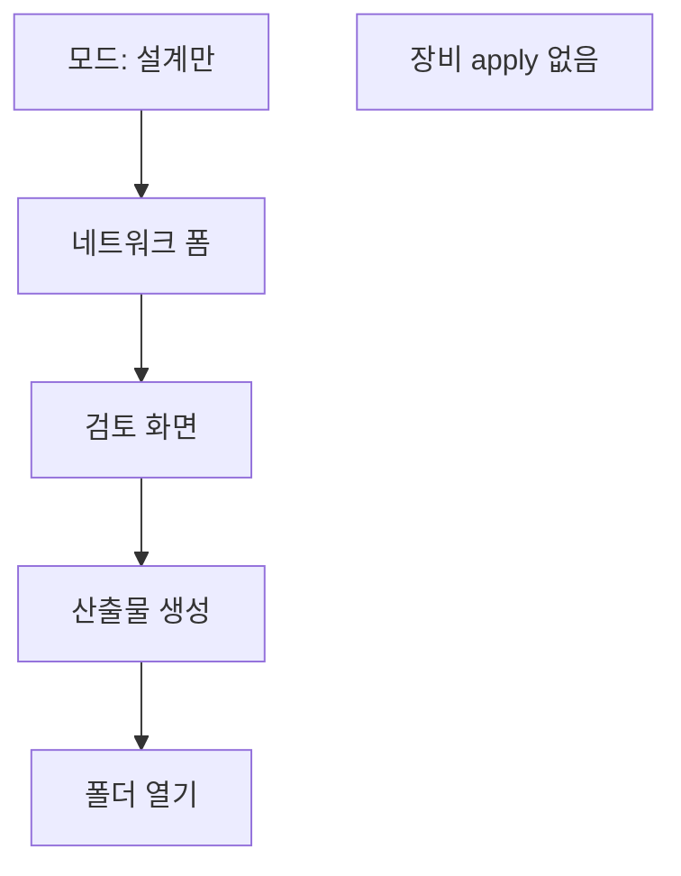
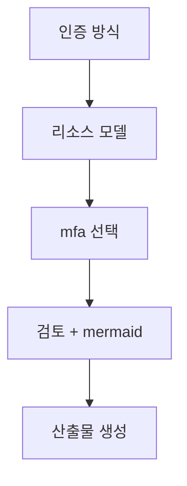
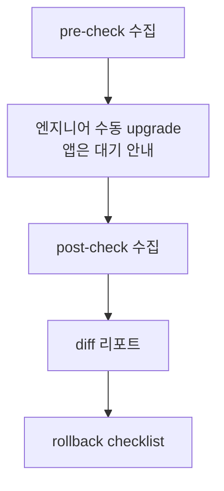

# ui flows and wireframes

version: 0.1  
parent: [gui_design.md](gui_design.md)

---

## 1. app entry



---

## 2. health_check — primary field flow

엔지니어 **기대 경로**: target mode → mgmt ip + id/pw → (세션 유지) → 점검 → **인앱** 리포트.



### 2.0 multiple mode



### 2.1 fixture 분기



---

## 3. session + profile (per mgmt ip)



---

## 4. initial_setup — design-only



---

## 5. vpe_macro — design-only



---

## 6. os upgrade (phase 2)



---

## 7. ascii wireframe — connection screen (primary)

```
+----------------------------------------------------------+
|  Health Check  >  Step 1/4  |  장비 연결                  |
+----------------------------------------------------------+
|  Target Mode:  (•) Single   ( ) Multiple                  |
|                                                          |
|  Platform:    [ BIG-IP TMOS (VE)  ▼ ]   ← TMOS only ph.1 |
|                                                          |
|  --- Single ---                                          |
|  라벨         [____________________________]             |
|  MGMT IP      [________________]  Port [443]             |
|  사용자 ID    [____________________________]             |
|  비밀번호     [****************************]  [👁]         |
|                                                          |
|  --- Multiple: device table + shared ID/PW above ---     |
|                                                          |
|  [ ] Fixture Mode                                        |
|  세션: 203.0.113.10 — logged in as admin (until exit)    |
|                                                          |
|     [ Test Connection ] [ Disconnect ]  [ Next > ] [Cancel]|
|  같은 IP 작업 중에는 로그인 상태를 유지합니다.             |
+----------------------------------------------------------+
```

---

## 8. job state (gui ↔ backend)

| ui state | backend |
|----------|---------|
| idle | — |
| validating | pydantic validators |
| connecting | `BigipClient.authenticate` |
| collecting | `TmosCollector.collect` |
| rendering | `render_*_report` |
| completed | `JobStatus.completed` |
| failed | `JobStatus.failed` + exceptions.json |

---

## 9. error ux matrix

| error | user message | recovery |
|-------|--------------|----------|
| ssl verify fail | 인증서 검증 실패. lab이면 지문 신뢰 선택 | tls 옵션 |
| 401 | 로그인 실패. id/pw 확인 | 재입력 |
| timeout | 장비 응답 없음. ip/망 확인 | retry |
| change blocked | 변경 모드 꺼짐 (정상) | info only |

---

*end of ui flows*
